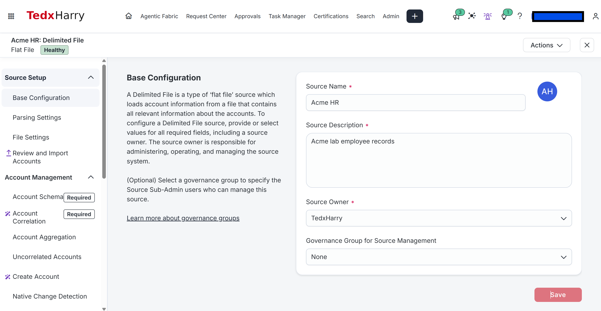
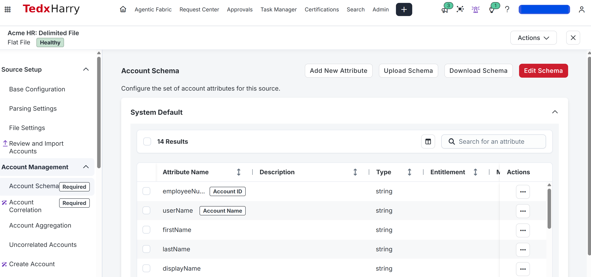
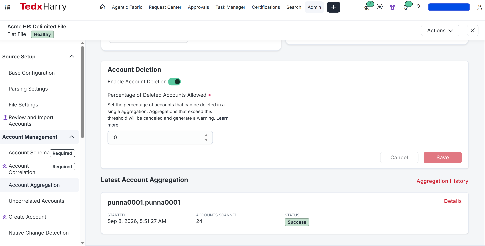
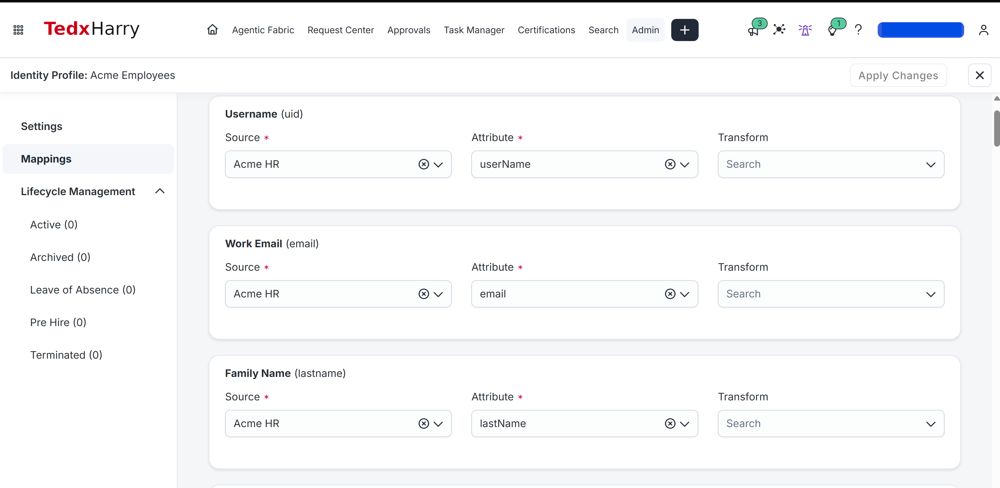
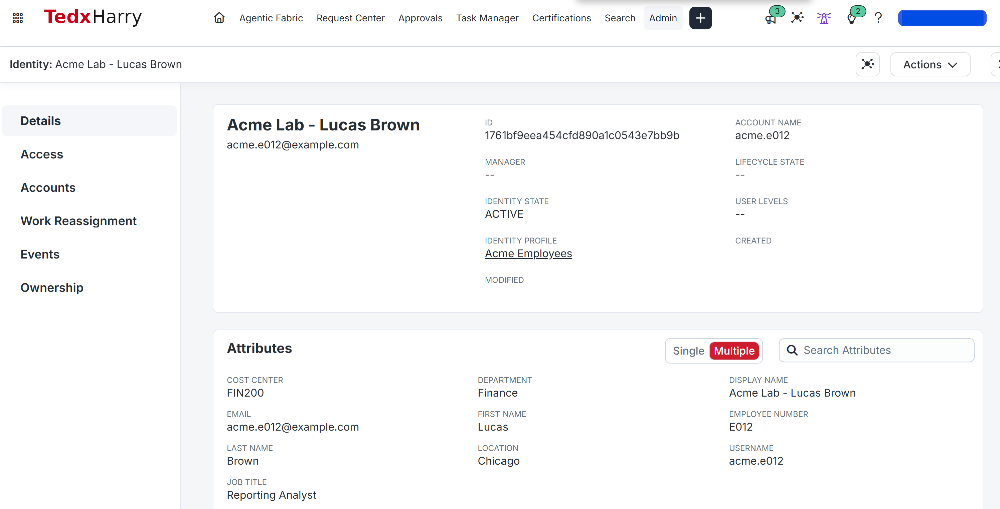

<a id="ar-001--import-acmes-hr-records"></a>

# AR-001: Import Acme's HR Records

<a id="goal"></a>

In this lab, you'll import the 24 Acme HR records, map their identity attributes and verify the resulting identities.

<a id="before-you-configure-anything"></a>

<a id="if-you-stopped-midway-or-want-to-repeat-this-lab"></a>

## Before you start

Use the [Module 1 configuration record](../../M01-STATE.md) for actual environment values and the required retained state.

<a id="session-for-this-lab"></a>

Use your ISC administrator session.

<a id="prerequisites"></a>

- ISC training tenant access with permission to create sources and identity profiles.
- The course HR CSV: [acme-hr-baseline.csv](../../datasets/acme-hr-baseline.csv).

Your existing Active Directory source is not used yet. AD work begins in AR-003. Before importing new identities, check that existing automatic role assignments and identity-triggered workflows will not grant unrelated access to the Acme test population.

<a id="starting-state"></a>

For a first run:

- `Acme HR` does not exist.
- `Acme Employees` does not exist.
- `acme.e001` through `acme.e024` do not already exist as the Acme lab identities.

If you already completed this lab once, reuse the existing Acme HR source and Acme Employees profile instead of creating duplicates.

## Follow the steps

<a id="1-inspect-the-hr-file"></a>

<a id="lab-files"></a>

### 1. Download the HR file

1. Open the [HR baseline CSV](../../datasets/acme-hr-baseline.csv).
2. Select **Download raw file**.
3. Save it as `acme-hr-baseline.csv`.
4. Make a working copy named `acme-hr-working.csv`.
5. Open the working copy and confirm the first row begins with:

```text
employeeNumber,userName,firstName
```

The file contains **24 employees and 14 columns**.

**Check:** You have a comma-delimited UTF-8 CSV with all 24 employee rows.

<a id="2-create-the-hr-source"></a>

### 2. Create the Acme HR source

1. Open **Admin > Connections > Sources**.
2. Select **Create New**.
3. Find **Delimited File** and choose **Configure** or **Standard Setup**.
4. Enter:

| Setting | Value |
|---|---|
| Name | Acme HR |
| Description | Acme lab employee records |
| Owner | Your ISC administrator |

5. Use the file-based connection option if prompted.
6. Leave provisioning disabled for this HR feed.
7. Save the source.

**Check:** `Acme HR` appears under **Admin > Connections > Sources** as a Delimited File source.

Reference: [Source configuration](https://documentation.sailpoint.com/saas/help/sources/config_sources.html)



<!-- AUTHOR_SCREENSHOT_START: AR-001-01 -->

> **Author: Capture screenshot**
>
> **Filename:** `AR-001-01-hr-source.png`
>
> **Show:** the Acme HR source name and type.

<!-- AUTHOR_SCREENSHOT_END: AR-001-01 -->

<a id="3-define-the-account-schema"></a>

<a id="completion-checklist"></a>

### 3. Configure the account schema

1. Open **Acme HR > Account Management > Account Schema**.
2. Use **Upload Schema** with `acme-hr-working.csv` if available.
3. For each missing attribute, select **Add New Attribute**, enter its exact name from the list below, select **String**, leave Entitlement and Multi-Valued off, and save.
4. Keep the CSV attributes as **String** values.
5. Set:

| Setting | Value |
|---|---|
| Account ID | employeeNumber |
| Account Name | userName |

6. Verify the schema contains these 14 attributes:

```text
employeeNumber
userName
firstName
lastName
displayName
email
department
title
managerEmployeeNumber
location
employeeType
costCenter
status
startDate
```

7. Save the schema.

Set the identifying attributes before importing accounts. [Account schemas](https://documentation.sailpoint.com/saas/help/accounts/schema.html)

**Check:** `employeeNumber` is Account ID, `userName` is Account Name, and all 14 CSV attributes exist.



<!-- AUTHOR_SCREENSHOT_START: AR-001-02 -->

> **Author: Capture screenshot**
>
> **Filename:** `AR-001-02-account-schema.png`
>
> **Show:** the schema with Account ID and Account Name visible.

<!-- AUTHOR_SCREENSHOT_END: AR-001-02 -->

Before importing, open **Source Setup > Parsing Settings** and select delimited parsing. Open **File Settings**, set the delimiter to a comma, and confirm the first row supplies column names. Save. If a preview is offered, confirm it shows 14 separate columns.

<a id="4-import-the-accounts"></a>

<a id="confirm-the-file-will-parse-as-columns"></a>

### 4. Import the HR accounts

1. Open **Acme HR > Account Management > Account Aggregation**.
2. Upload `acme-hr-working.csv`.
3. Wait for the aggregation to complete.
4. Open **Acme HR > Account Management > Accounts**.
5. Verify the source contains **24 accounts**.
6. Search for `acme.e012` and open Lucas Brown's HR account.
7. Confirm:

| Attribute | Expected value |
|---|---|
| Account ID / employeeNumber | E012 |
| userName | acme.e012 |
| department | Finance |
| costCenter | FIN200 |

**Check:** The latest aggregation succeeds, Acme HR contains 24 accounts, and Lucas's HR account contains the expected values.

Reference: [Loading account data](https://documentation.sailpoint.com/saas/help/accounts/loading_data.html)



<!-- AUTHOR_SCREENSHOT_START: AR-001-03 -->

> **Author: Capture screenshot**
>
> **Filename:** `AR-001-03-hr-import.png`
>
> **Show:** the completed aggregation and 24-account result.

<!-- AUTHOR_SCREENSHOT_END: AR-001-03 -->

<a id="5-create-the-identity-profile"></a>

### 5. Create the Acme Employees identity profile

1. Open **Admin > Identity Management > Identity Profiles**.
2. Select **Create New**.
3. Enter:

| Setting | Value |
|---|---|
| Name | Acme Employees |
| Source | Acme HR |

4. Save the profile.
5. Open **Mappings**.
6. For each row below, locate the identity attribute, select **Acme HR** as Source and the listed account Attribute. Leave Transform empty for these direct mappings:

| Identity attribute | Acme HR attribute |
|---|---|
| User Name (`uid`) | userName |
| First Name (`firstname`) | firstName |
| Last Name / Family Name (`lastname`) | lastName |
| Display Name (`displayName`) | displayName |
| Work Email (`email`) | email |
| Employee Number (`identificationNumber`) | employeeNumber |
| Department (`department`) | department |
| Title (`title`) | title |
| Location (`location`) | location |
| Cost Center (`costCenter`) | costCenter |

7. Leave `managerEmployeeNumber`, `employeeType`, `status`, and `startDate` on the HR account for now.
8. Save the mappings.

Reference: [Identity profiles](https://documentation.sailpoint.com/saas/help/setup/identity_profiles.html)

**Check:** All ten mappings are saved and `identificationNumber` maps to `employeeNumber`. AR-002 uses this value for manager correlation.



<!-- AUTHOR_SCREENSHOT_START: AR-001-04 -->

> **Author: Capture screenshot**
>
> **Filename:** `AR-001-04-identity-mappings.png`
>
> **Show:** the saved identity mappings.

<!-- AUTHOR_SCREENSHOT_END: AR-001-04 -->

<a id="5a-apply-the-mappings-and-check-processing"></a>

### 6. Apply the profile and process identities

1. In **Acme Employees**, select **Apply Changes**.
2. Open **Admin > Dashboard > Monitor**.
3. Wait for identity processing to finish.
4. Return to **Identity Profiles**.
5. Confirm there are no unresolved Identity Exceptions for the Acme population.

Reference: [Identity processing](https://documentation.sailpoint.com/saas/help/setup/identity_processing.html)

**Check:** Processing completes successfully and Acme Employees is no longer waiting for required processing.

<a id="6-verify-the-identities"></a>

### 7. Verify the Acme identities

1. Open **Admin > Identity Management > Identities**.
2. Search for `acme.e012`.
3. Open Lucas Brown.
4. Verify:

| Identity attribute | Expected value |
|---|---|
| Username | acme.e012 |
| Display Name | Acme Lab - Lucas Brown |
| Employee Number | E012 |
| Department | Finance |
| Cost Center | FIN200 |
| Location | Chicago |
| Title | Reporting Analyst |

5. Open Lucas's **Accounts** tab.
6. Open the **Acme HR** account and confirm the raw HR values agree with the identity values.
7. Confirm the Acme Employees population contains **24 identities**.

Repeat the account-to-identity comparison for these employees:

| Employee | Expected department |
|---|---|
| E001 ; Morgan Reed | IT |
| E018 ; Henry Anderson | Engineering |
| E023 ; Abigail Lewis | Security |

**Check:** Acme HR has 24 accounts, Acme Employees has 24 identities, and Lucas is Finance / FIN200 with Employee Number E012.



<!-- AUTHOR_SCREENSHOT_START: AR-001-05 -->

> **Author: Capture screenshot**
>
> **Filename:** `AR-001-05-lucas-baseline.png`
>
> **Show:** Lucas's identity and Acme HR account.

<!-- AUTHOR_SCREENSHOT_END: AR-001-05 -->

<a id="if-the-result-doesnt-match"></a>

## Check the result

### What you will finish with

| Item | Expected result |
|---|---|
| HR source | Acme HR |
| HR accounts | 24 |
| Identity profile | Acme Employees |
| Acme identities | 24 |
| Lucas username | acme.e012 |
| Lucas department | Finance |
| Lucas cost center | FIN200 |

---

### Final verification

- [ ] Acme HR exists and contains 24 accounts.
- [ ] `employeeNumber` is Account ID.
- [ ] `userName` is Account Name.
- [ ] Acme Employees exists and uses Acme HR.
- [ ] All ten identity mappings are saved.
- [ ] `identificationNumber` maps to `employeeNumber`.
- [ ] Identity processing completed successfully.
- [ ] Acme Employees contains 24 identities.
- [ ] Lucas is `acme.e012`, Finance, FIN200, E012.
- [ ] No duplicate Acme source or identity profile was created.

## Finish

<a id="what-you-should-leave-in-place"></a>

### Leave this in place

Keep the Acme HR source, Acme Employees identity profile, 24 imported HR accounts, and 24 identities exactly as configured.

Next: **[AR-002: Resolve the Manager Hierarchy](../AR-002/README.md)**

[Labs Home](../README.md)
