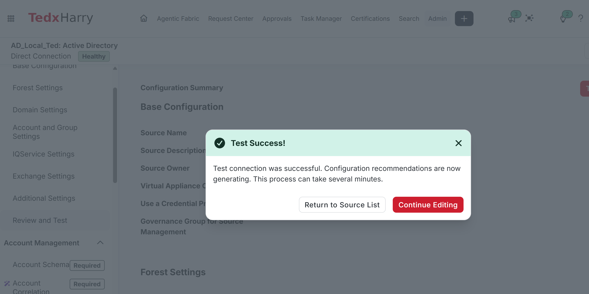
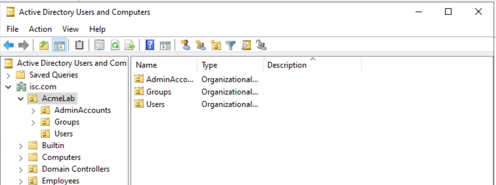
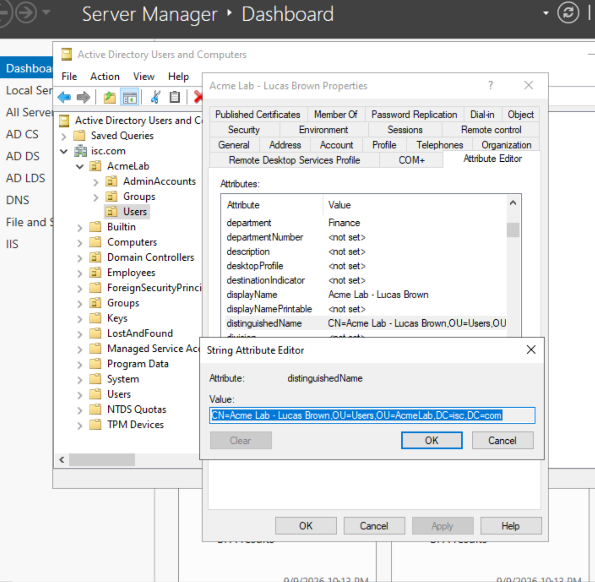
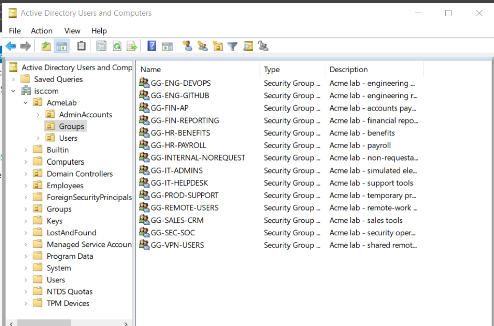
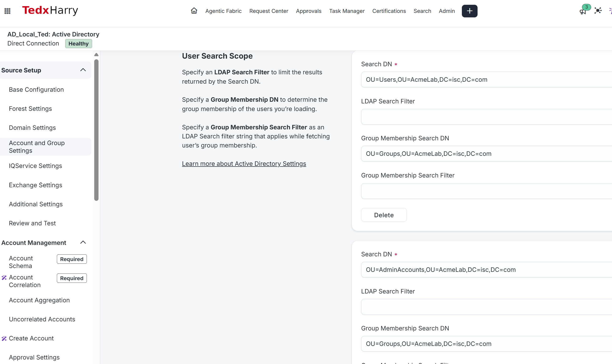
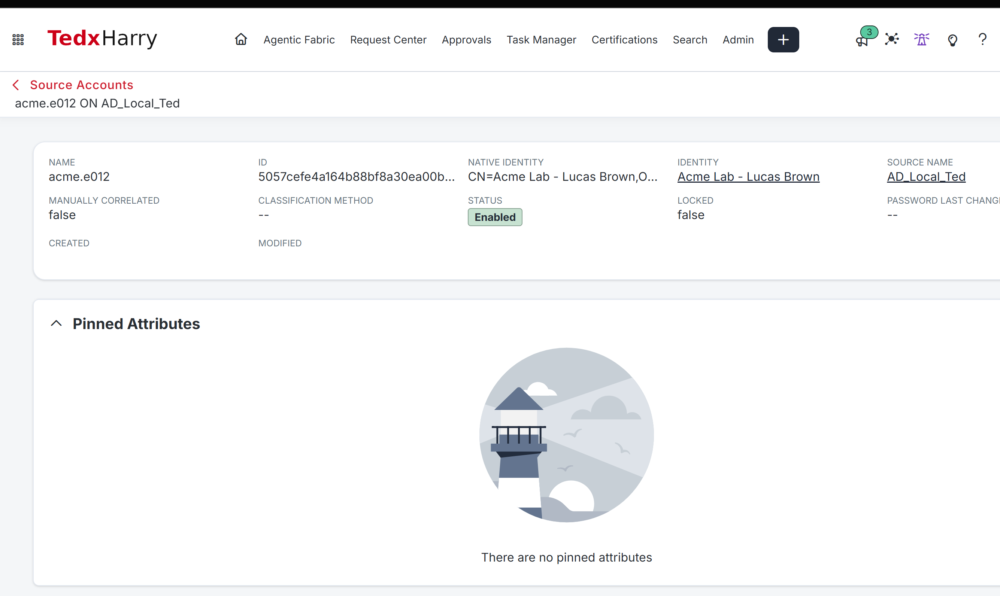
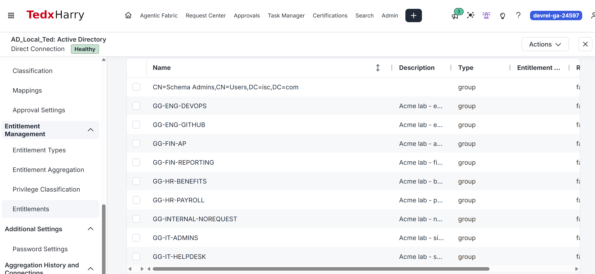

<a id="ar-003--prepare-and-aggregate-the-ad-lab"></a>

<a id="ar-003--validate-ad-and-aggregate-the-lab-data"></a>

# AR-003: Prepare and Aggregate the AD Lab

<a id="goal"></a>

In this lab, you'll create the Acme lab OUs, Lucas's AD account and the course groups, update the source search scopes, and aggregate them into ISC.

<a id="if-you-stopped-midway-or-want-to-repeat-this-lab"></a>

## Before you start

AR-004 will correlate Lucas's existing AD account to his ISC identity.

Use the [Module 1 configuration record](../../M01-STATE.md) for actual environment values and the required retained state.

<a id="session-for-this-lab"></a>

Use your ISC administrator session for ISC steps and your AD administration workstation for directory steps.

<a id="prerequisites"></a>

- Complete [AR-001](../AR-001/README.md) and [AR-002](../AR-002/README.md).
- Existing Active Directory source connected to the training domain.
- Permission to administer the ISC AD source.
- Permission to create OUs, users, and groups in the isolated AD lab area.
- Access to Active Directory Users and Computers.

<a id="environment-requirements"></a>

- The AD source passes **Test Connection**.
- A dedicated training location is available for `AcmeLab`.
- `acme.e012` is not already used by an unrelated account.
- The 14 Acme course group names are available for this lab.
- You can add the AcmeLab OUs to the AD source search scopes.

## Follow the steps

<a id="1-identify-and-test-your-ad-source"></a>

### 1. Test the existing AD source

1. Open **Admin > Connections > Sources**.
2. Select your existing **Active Directory** source.
3. Record its source name and source ID.
4. Open **Review and Test**.
5. Select **Test Connection**.

Reference: [AD Review and Test](https://documentation.sailpoint.com/connectors/active_directory/help/common/topics/review_and_test.html)

**Check:** Test Connection succeeds.

<!-- AUTHOR_SCREENSHOT_START: AR-003-01 -->

> **Author: Capture screenshot**
>
> **Filename:** `AR-003-01-connection-test.png`
>
> **Show:** the AD source name and successful connection test.

<!-- AUTHOR_SCREENSHOT_END: AR-003-01 -->



The AD connection test succeeds. AD_Local_Ted is the source used in this example; select your own AD source.

<a id="2-prepare-the-ad-lab-locations"></a>

<a id="completion-checklist"></a>

### 2. Create the AcmeLab OU structure

On your AD administration workstation:

1. Open **Server Manager > Tools > Active Directory Users and Computers**.
2. Navigate to the parent OU reserved for your training objects.
3. Right-click the training parent and select **New > Organizational Unit**. Enter **AcmeLab** and select **OK**.
4. Right-click AcmeLab and repeat **New > Organizational Unit** for each name:

```text
Users
AdminAccounts
Groups
```

5. Enable **View > Advanced Features**.
6. Open each child OU's **Properties > Attribute Editor**.
7. Record the `distinguishedName` for:
   - Users
   - AdminAccounts
   - Groups

Example only:

```text
OU=Users,OU=AcmeLab,DC=training,DC=example,DC=com
```

Use the actual DN from your directory.

**Check:** All three OUs exist and you recorded their actual DNs.

<!-- AUTHOR_SCREENSHOT_START: AR-003-02 -->

> **Author: Capture screenshot**
>
> **Filename:** `AR-003-02-lab-ous.png`
>
> **Show:** AcmeLab expanded with Users, AdminAccounts, and Groups.

<!-- AUTHOR_SCREENSHOT_END: AR-003-02 -->



AcmeLab contains Users, AdminAccounts and Groups. Copy the OU DNs from your own domain.

<a id="3-prepare-lucass-ad-account"></a>

<a id="6-aggregate-and-inspect-lucass-account"></a>

### 3. Create Lucas's AD account

1. In Active Directory Users and Computers, open **AcmeLab > Users**.
2. Right-click **Users > New > User**.
3. Enter:

| Field | Value |
|---|---|
| First name | Lucas |
| Last name | Brown |
| Full name | Acme Lab - Lucas Brown |
| User logon name | acme.e012 |
| UPN suffix | Your training domain suffix |
| Pre-Windows 2000 logon name | acme.e012 |

Before selecting the suffix, read the dropdown beside **User logon name**. Use the configured training-domain suffix, without taking a value from the HR email column. For example, `acme.e012` plus `@isc.com` forms the UPN `acme.e012@isc.com`. If more than one suffix is offered, use the established suffix for standard users in this training domain. [See the UPN lookup walkthrough](../AR-005/README.md#find-and-record-your-upn-suffix).

4. Select **Next**.
5. Set a password that meets the domain policy. Do not record the password in the course evidence.
6. Retain domain-required password settings, record the chosen enabled/disabled account state, then select **Next > Finish**.
7. Open Lucas's **Properties**. Use **General** for Display name and **Organization** for Department and Title.
8. Set:

| Attribute | Value |
|---|---|
| Display name | Acme Lab - Lucas Brown |
| Department | Finance |
| Title | Reporting Analyst |

9. Select **Apply**, reopen the properties to confirm the saved values, then open **Attribute Editor** and record Lucas's `distinguishedName`.

**Check:** Lucas exists under AcmeLab/Users with `sAMAccountName = acme.e012`.

<!-- AUTHOR_SCREENSHOT_START: AR-003-03 -->

> **Author: Capture screenshot**
>
> **Filename:** `AR-003-03-lucas-account.png`
>
> **Show:** Lucas's account and distinguishedName.

<!-- AUTHOR_SCREENSHOT_END: AR-003-03 -->



Lucas lives under AcmeLab/Users. This image shows his distinguishedName; also check the Account tab for acme.e012 and your logon suffix.

<a id="4-create-the-14-lab-groups"></a>

<a id="7-aggregate-and-inspect-the-groups"></a>

### 4. Create the 14 course groups

Right-click **AcmeLab > Groups**, select **New > Group**, enter the name from the table and select the settings below. Select **OK**, open the group’s **Properties**, enter its description, and select **Apply**. Repeat for all 14 names.

Use:

- **Group scope:** Global
- **Group type:** Security

Create these exact names:

| Group name | Description |
|---|---|
| GG-VPN-USERS | Acme lab - shared remote connectivity |
| GG-REMOTE-USERS | Acme lab - remote-work tools |
| GG-FIN-AP | Acme lab - accounts payable |
| GG-FIN-REPORTING | Acme lab - financial reporting |
| GG-HR-PAYROLL | Acme lab - payroll |
| GG-HR-BENEFITS | Acme lab - benefits |
| GG-IT-HELPDESK | Acme lab - support tools |
| GG-IT-ADMINS | Acme lab - simulated elevated access |
| GG-ENG-GITHUB | Acme lab - engineering repository access |
| GG-ENG-DEVOPS | Acme lab - engineering operations |
| GG-SALES-CRM | Acme lab - sales tools |
| GG-SEC-SOC | Acme lab - security operations |
| GG-PROD-SUPPORT | Acme lab - temporary production support |
| GG-INTERNAL-NOREQUEST | Acme lab - non-requestable control |

Keep the groups empty and do not nest them into Domain Admins or other privileged groups.

Open `GG-VPN-USERS > Properties > Attribute Editor` and record its `distinguishedName`.

**Check:** All 14 groups exist under AcmeLab/Groups.

<!-- AUTHOR_SCREENSHOT_START: AR-003-04 -->

> **Author: Capture screenshot**
>
> **Filename:** `AR-003-04-ad-groups.png`
>
> **Show:** the 14 groups in AD.

<!-- AUTHOR_SCREENSHOT_END: AR-003-04 -->



The 14 business groups are present in AcmeLab/Groups. The baseline group is added in AR-005.

### 5. Add the AcmeLab locations to the ISC AD source

1. Open **Admin > Connections > Sources > your AD source**.
2. Open **Account and Group Settings**.
3. Record the existing search-scope settings before making changes.

<a id="set-the-user-searches"></a>

#### User Search Scope

Add the actual DNs for:

- AcmeLab/Users
- AcmeLab/AdminAccounts

For these lab-specific entries, leave the optional LDAP filter blank unless your environment requires a documented filter.

<a id="set-the-group-search"></a>

#### Group Search Scope

Add the actual DN for:

- AcmeLab/Groups

<a id="check-membership-searches-and-reopen-the-saved-settings"></a>

#### Group Membership Search DN

For the AcmeLab user-search entries, set the membership search to the actual AcmeLab/Groups DN so the connector can read memberships for the lab users.

4. Save the source configuration.
5. Leave the page and reopen **Account and Group Settings**.
6. Confirm the values were saved.

Reference: [AD Account and Group Settings](https://documentation.sailpoint.com/connectors/active_directory/help/integrating_active_directory/account_and_group_settings.html)

**Check:**

- User Search Scope covers Users and AdminAccounts.
- Group Search Scope covers Groups.
- Membership search for the lab users can reach AcmeLab/Groups.
- Existing source coverage was not removed.

<!-- AUTHOR_SCREENSHOT_START: AR-003-05 -->

> **Author: Capture screenshot**
>
> **Filename:** `AR-003-05-source-scopes.png`
>
> **Show:** the saved user, group, and membership-search settings.

<!-- AUTHOR_SCREENSHOT_END: AR-003-05 -->



User Search Scope includes Users and AdminAccounts, with Group Membership Search DN pointing to Groups. Scroll to the separate Group Search Scope and verify it too; that section is outside this image.

<a id="5-update-the-ad-source-settings-before-aggregation"></a>

<a id="open-and-record-the-current-configuration"></a>

### 6. Run account aggregation

1. Open the AD source's **Account Management > Account Aggregation**.
2. Confirm the saved search scopes include your lab OUs. Keep account-deletion settings unchanged and select **Start Aggregation**. No Delta Aggregation toggle is required.
3. Wait for completion.
4. Open **Account Management > Accounts**.
5. Search for `acme.e012`.
6. Open Lucas's AD account.
7. Verify:

| Attribute | Expected result |
|---|---|
| sAMAccountName | acme.e012 |
| DN | Matches the AD value recorded earlier |
| Source | Your Active Directory source |

8. Record whether the account is currently correlated.
9. Inspect **Aggregation History** and record the completed status, scanned count and any warnings. Keep the expanded search coverage.

Lucas can be uncorrelated at this stage. AR-004 handles correlation of this existing AD account to Lucas's ISC identity.

Reference: [Loading account data](https://documentation.sailpoint.com/saas/help/accounts/loading_data.html)

**Check:** Lucas's AD account is visible on the ISC AD source with the expected sAMAccountName and DN.

<!-- AUTHOR_SCREENSHOT_START: AR-003-06 -->

> **Author: Capture screenshot**
>
> **Filename:** `AR-003-06-account-import.png`
>
> **Show:** the completed account aggregation and Lucas's imported AD account.

<!-- AUTHOR_SCREENSHOT_END: AR-003-06 -->



The imported AD account is acme.e012. This example is already linked to Lucas; preserve a correct existing link. Open the account attributes to compare sAMAccountName and the full native identity with AD.

### 7. Run entitlement aggregation

For the separate ISC ID and native group value, follow [the entitlement lookup](../../LAB-VALUES.md#separate-entitlement-ids-from-native-group-values). Record both beside the source name.

1. Open the same AD source.
2. Open **Entitlement Management > Entitlement Aggregation**.
3. Select **Start Aggregation**.
4. Wait for completion.
5. Open **Entitlement Management > Entitlements**.
6. Search for each of the 14 Acme groups.
7. Open `GG-VPN-USERS`.
8. Record:
   - source
   - entitlement attribute/type
   - entitlement value/native identifier
   - ISC entitlement ID, if displayed

Reference: [Entitlement aggregation](https://documentation.sailpoint.com/saas/help/loading_entitlements/aggregating_entitlements.html)

**Check:** All 14 Acme groups are visible as entitlements on the correct AD source.

<!-- AUTHOR_SCREENSHOT_START: AR-003-07 -->

> **Author: Capture screenshot**
>
> **Filename:** `AR-003-07-entitlements.png`
>
> **Show:** the completed entitlement aggregation, the Acme groups, and GG-VPN-USERS details.

<!-- AUTHOR_SCREENSHOT_END: AR-003-07 -->



The AD source contains the imported lab groups. Other groups can also appear. Search for all 14 course names; this cropped list does not show every group.

## Check the result

<a id="copy-your-actual-ou-paths"></a>

### What you will finish with

```text
AcmeLab
├── Users
│   └── Acme Lab - Lucas Brown (acme.e012)
├── AdminAccounts
└── Groups
    ├── GG-VPN-USERS
    ├── GG-REMOTE-USERS
    └── 12 additional course groups
```

ISC will contain:

- Lucas's AD account on the AD source.
- All 14 Acme security groups as entitlements.

---

### Final verification

- [ ] AD Test Connection succeeds.
- [ ] AcmeLab exists with Users, AdminAccounts, and Groups.
- [ ] Lucas exists in AcmeLab/Users as `acme.e012`.
- [ ] Lucas's DN is recorded.
- [ ] All 14 course groups exist in AcmeLab/Groups.
- [ ] GG-VPN-USERS DN is recorded.
- [ ] ISC User Search Scope covers Users and AdminAccounts.
- [ ] ISC Group Search Scope covers Groups.
- [ ] Membership search can reach the lab Groups OU.
- [ ] Account aggregation succeeds.
- [ ] Lucas's AD account is visible in ISC.
- [ ] Entitlement aggregation succeeds.
- [ ] All 14 groups are visible as entitlements.
- [ ] GG-VPN-USERS native value is recorded.

<a id="if-something-is-missing"></a>

## Finish

<a id="what-you-should-leave-in-place"></a>

### Leave this in place

Keep:

- AcmeLab and all three child OUs.
- Lucas's AD account.
- All 14 groups.
- The added AD source scope coverage.

Do not make the groups requestable yet.

Next: **[AR-004: Correlate Lucas's Existing AD Account](../AR-004/README.md)**.

[Previous: AR-002](../AR-002/README.md) · [Labs Home](../README.md)
